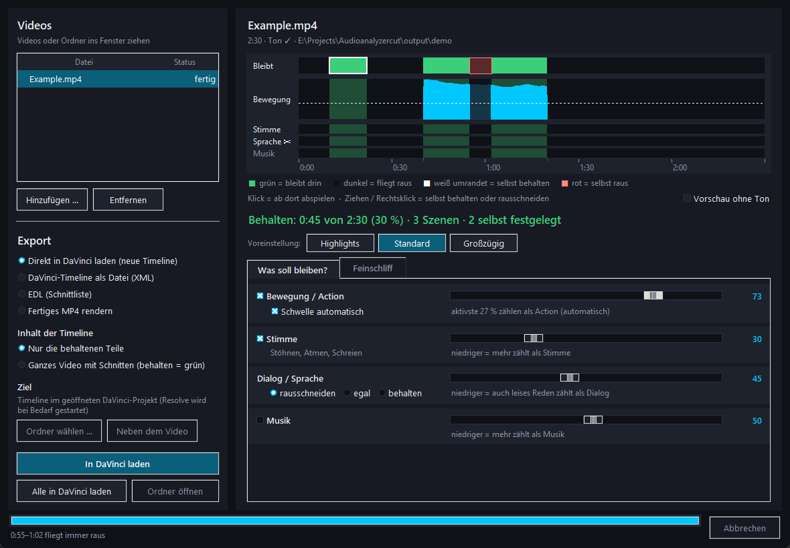

# Scenecut

Cuts long videos down to the scenes that matter – by motion and sound – and loads the result
straight into a DaVinci Resolve timeline (or writes XML / EDL / MP4).

One pass over picture and sound: about **1 minute per 100 minutes of video** on an RTX-class
GPU, then every slider change shows its result instantly.



## Requirements

- Windows 10/11, Python 3.12 (the version DaVinci Resolve's scripting expects)
- FFmpeg on `PATH` (`ffmpeg`, `ffprobe`, and `ffplay` for the preview)
- Optional: NVIDIA GPU – decoding uses NVDEC, MP4 export uses NVENC (falls back to CPU / x264)
- Optional: DaVinci Resolve **Studio** for loading timelines directly
  (*Preferences → System → General → External scripting using = Local*, then restart Resolve)

**Install:** run `install.bat` – it finds (or installs via winget) Python 3.12, creates a
`.venv` in this folder with the packages from `requirements.txt` and checks for FFmpeg.

**Start:** `start.bat` (no console window). Videos dropped onto `start.bat` are added right away.

Manual alternative: `pip install -r requirements.txt`, then `python scenecut_app.py`.

## Using it

1. **Drop videos or folders** anywhere into the window. They are analyzed one after the other;
   a second open is instant (analysis cache in `%LOCALAPPDATA%\Scenecut\cache`).
2. **Pick a preset** – *Highlights*, *Standard* (automatic per video), *Großzügig* – or set the
   categories yourself: motion / action, vocal sounds, dialogue (cut out / ignore / keep), music.
   The *Feinschliff* tab has minimum scene length, gap closing, padding and smoothing.
3. **Read the timeline**: the *Bleibt* lane and the green background show exactly what is kept.
   Click to play from there (ffplay, optionally muted).
4. **Fix outliers yourself**: drag over a range or right-click a stretch → *always keep* /
   *always cut*. These corrections win over all sliders and are saved per video.
   *Schnitt aus DaVinci übernehmen* does the same from your edit in Resolve: it reads the
   video's timeline back (read only) and turns what you deleted, trimmed or brought back into
   corrections. Every clip still in the timeline counts as kept, whatever its colour (also
   one half of a split clip); what you cut out or disable counts as removed.
   *Wegen Geschmack* (test version): the same menu can say a correction was made because of
   taste – how something is shown, not whether it is action (*Immer behalten / rausschneiden –
   Geschmack*, or *Festlegung hier als Geschmack markieren* for one that is already there, e.g.
   from DaVinci). It changes nothing in the cut; a pink bar above *Bleibt* shows it. The
   general decision is measured without these parts, and they are collected for a personal taste
   model later.
5. **Export**
   - *Direkt in DaVinci laden*: new timeline in the open Resolve project (Resolve is started if
     needed; existing timelines are never touched)
   - DaVinci timeline file (FCP7 XML) or EDL
   - finished MP4
   - Timeline content: only the kept parts, or the whole video cut at every scene edge
     (direct load colours kept parts green, the rest orange)

Every video remembers its own sliders (a video opened for the first time starts with those of the
video shown before); *Auf alle Videos anwenden* copies them to the whole list. Export uses each
video's own settings. The app's own settings are in `scenecut_settings.json` next to it.

## How it decides

- **Picture**: one sequential ffmpeg decode into 160×90 grayscale at 10 fps. Per frame the
  difference to the previous one, with camera motion removed by phase correlation – pans count
  less than motion in the picture. Cuts are isolated difference spikes.
- **Sound**: the whole track through YAMNet (`yamnet.onnx`) – speech, vocal sounds, music,
  silence per 0.48 s.
- **Decision** (*Entscheidung*):
  - *klassisch*: motion threshold as a percentile of the video itself (automatic split by
    default) OR vocal sounds keep a frame, every dialog hit cuts it out.
  - *kombiniert*: the same sliders pick WHICH scenes stay (e.g. with *Highlights*), then each
    picked piece grows to the whole action around it – as far as the motion averaged over
    30 s stays high or vocal sounds go on; talk in the middle does not end the scene.
    *Strenge* sets how far scenes grow, *Pausen in einer Szene* how long the action may calm
    down inside one. In the timeline a yellow bar marks what the growing adds, the yellow
    line in *Bewegung* is the 30 s motion it follows.
  - *nur mit Gesicht (Test)*, on top of either mode: cuts out where a face is visible in less
    than *Gesicht-Anteil* (Feinschliff) of the time, averaged over 10 s. The first time it is
    switched on for a video, faces are searched once (YuNet, `yunet.onnx`, 2 frames per second
    at 320×180, about 1 s per minute of video) and cached (`*.faces.npz`); the *Gesicht* lane
    shows them. On the reviewed videos so far it made both modes worse – faces are mostly
    visible in the story and talk that gets cut – so it is off by default.
  - Then hysteresis, gap closing, minimum length, edges snapped to cuts, and the manual
    corrections on top.

## Measuring and learning

Every correction is a label. `python evaluate.py` decides all cached videos with corrections
again without them and shows how much of what you wanted stays and how much of what you
removed goes – for *klassisch* and *kombiniert* (`--sweep`: several strictness levels,
`--preset Highlights`: start from an app preset).
A DaVinci read-back where you confirm that you went through the whole video counts fully:
everything in the timeline as wanted, everything else as not.

The analysis also stores YAMNet's 1024-value sound fingerprint per 0.96 s
(`*.embed.npz` in the cache) – the raw material for a classifier trained on your own labels
once enough videos are corrected.

## Command line

```bash
python fast_scan.py VIDEO [--motion-level 60] [--speech remove|ignore|keep] [--export xml,edl,mp4]
```

## Files

| File | |
|---|---|
| `scenecut_app.py` | the app (tkinter + tkinterdnd2) |
| `fast_scan.py` | analysis, decision, MP4 export, manual corrections |
| `davinci_timeline.py` | loads segments into a Resolve timeline |
| `davinci_api.py` | Resolve connection (vendored from the Hail Mary project) |
| `timeline_export.py` | FCP7 XML and CMX EDL files |
| `evaluate.py` | measures the decision against your corrections |
| `taste.py` | taste marks on corrections (test version) |
| `yamnet.onnx`, `yamnet_class_map.csv` | sound classification model |
| `yunet.onnx` | face detector (YuNet from the OpenCV model zoo, MIT licence) |

## Tests

```bash
python tests/test_fast_scan.py
python tests/test_davinci_timeline.py
python tests/test_timeline_export.py
python tests/test_taste.py
```

No GPU or Resolve needed; the Resolve tests use a small fake of its object model.
